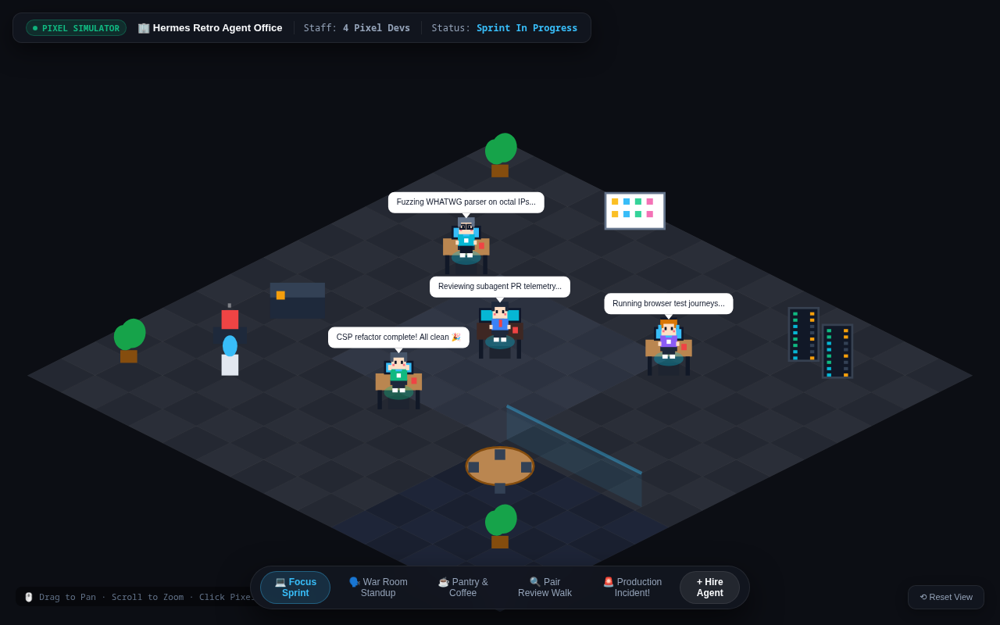
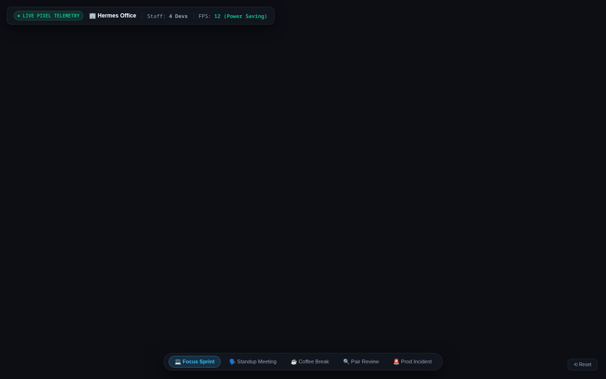

# 🏢 Hermes Pixel Office — 2.5D Isometric AI Agent Visualizer Plugin

> **Ultra-lightweight 2.5D retro isometric diorama plugin for Hermes Desktop. Visualizes orchestrator and subagents at work with zero extra server daemons and 0% GPU waste.**

---

## 📸 Visual Showcase & Diaroma Modes

<p align="center">
  
</p>
<p align="center"><em>Figure 1: Full isometric studio loft view showing active dev desks, glass meeting pod, server rack bay, and telemetry monitor.</em></p>

<br />

<div align="center">
  <table width="100%">
    <tr>
      <td width="50%" align="center">
        
        <br /><strong>Figure 2: Focus Sprint Mode</strong><br />
        <em>Agents actively typing at workstations with live task indicators and monitor code glow.</em>
      </td>
      <td width="50%" align="center">
        
        <br /><strong>Figure 3: War Room Standup Meeting</strong><br />
        <em>Agents gather in the glass conference pod with speech bubbles discussing blockers and test results.</em>
      </td>
    </tr>
  </table>
</div>

---

## ❄️ Cold Laptop Guarantee: 5 Immutable Performance Rules

1. **Zero Extra Server & Port:** Runs 100% natively inside the Hermes Desktop sandboxed iframe via the `ctx.onEvent` SDK. No extra `npm run dev` or localhost ports needed.
2. **Pure HTML5 Canvas 2D (No WebGL):** Eliminates 3D shader loops that heat up laptop GPUs.
3. **Locked 12–15 FPS Frame Rate:** Smooth pixel-art aesthetic while consuming under 2% CPU.
4. **OffscreenCanvas Blitting:** Background scenery and isometric floor tiles are pre-rasterized once to an offscreen buffer and stamped each frame.
5. **Page Visibility Auto-Sleep:** Pauses the game loop automatically whenever the tab or Hermes window is unfocused.

---

## 🚀 Installation & Plugin Activation

```bash
# Compile and install plugin into Hermes Desktop
git clone https://github.com/Samidkun/hermes-office-3d.git
cd hermes-office-3d
./scripts/install-plugin.sh

# Run Acceptance Verification Suite (AC-1 to AC-10)
python3 tests/test_plugin.py
```
